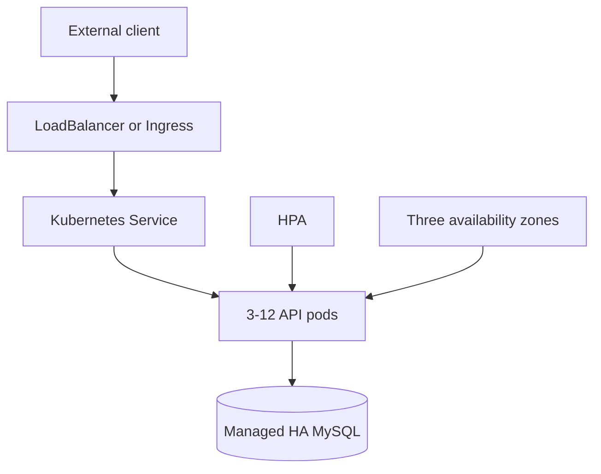

# Production-ready Kubernetes application

This repository is a complete solution to the Cloud Infrastructure Interview Test. It modernizes the sample API, builds a hardened container, deploys it through Helm, distributes replicas across three availability zones, exposes it externally, and automates validation and release.

## Requirement coverage

| Requirement | Implementation |
| --- | --- |
| Build and publish a container image | Multi-stage `Dockerfile`; tag-based GitHub Actions release publishes a multi-architecture image to GHCR with SBOM, provenance, and keyless signature |
| Deploy to Kubernetes | Parameterized Helm chart under `deploy/helm/interview-api` |
| External access | `LoadBalancer` service by default; optional Ingress; local `NodePort` on `127.0.0.1:8080` |
| High availability in three zones | Minimum three replicas, hard zone spreading, hostname anti-affinity, zero-unavailable rolling updates, PDB, HPA, and health probes |
| Private registry authentication | Standard `imagePullSecrets` value and a service account without automatic API credentials |
| Automated local environment | One command creates a three-worker kind cluster, builds/loads the image, deploys MariaDB and Helm, and runs smoke tests |
| Tests | Five API tests, deployment smoke test, Helm test, and optional k6 load test |
| Terraform | Reproducible four-node local kind cluster in `terraform/` |

## Architecture



The production database is deliberately external to the application chart. A managed, multi-zone MySQL-compatible service provides backups, failover, patching, and storage durability more safely than an application-owned single StatefulSet. The included MariaDB deployment is ephemeral and only for local testing.

## Quick start: full local Kubernetes environment

Prerequisites: Docker, kind, kubectl, Helm 3, curl, and jq.

```bash
./scripts/bootstrap-kind.sh
```

The script creates one control-plane and three worker nodes, each worker labeled as a separate zone. It then verifies the API at `http://127.0.0.1:8080`.

```bash
curl http://127.0.0.1:8080/posts
./scripts/destroy-kind.sh
```

To provision only the kind cluster with Terraform:

```bash
terraform -chdir=terraform init
terraform -chdir=terraform apply
./scripts/bootstrap-kind.sh
```

The bootstrap script detects and reuses the existing cluster.

## Local application development

```bash
npm ci --ignore-scripts
npm run lint
npm run typecheck
npm test
npm run build
docker compose up --build
```

Docker Compose runs the migration as a one-shot service before starting the API on `http://127.0.0.1:3000`.

## API

```bash
curl http://127.0.0.1:3000/health/live
curl http://127.0.0.1:3000/health/ready
curl http://127.0.0.1:3000/posts
curl -X POST http://127.0.0.1:3000/posts \
  -H 'Content-Type: application/json' \
  -d '{"title":"Production","text":"Ready","categories":[{"name":"devops"}]}'
```

Request bodies, IDs, and pagination are validated. List requests are capped at 100 records to protect the database and response time.

## Production deployment

Create the database credentials outside the chart, preferably with External Secrets or your cloud secret manager:

```bash
kubectl -n interview create secret generic interview-api-database \
  --from-literal=username='posts' \
  --from-literal=password='replace-this'

helm upgrade --install interview-api deploy/helm/interview-api \
  --namespace interview --create-namespace \
  --set image.repository=ghcr.io/ORG/infrastructure-interview-api \
  --set image.tag=1.0.0 \
  --set database.host=production-database.example.internal \
  --set database.ssl=true \
  --atomic --timeout 5m
```

Use an immutable image digest in a real production values file. If the registry is private, create a Docker registry secret and set:

```yaml
imagePullSecrets:
  - name: registry-credentials
```

The pre-install/pre-upgrade migration Job must succeed before Helm rolls out the application. `--atomic` automatically returns the release to its prior state when a deployment fails.

## Publishing the required public image

1. Push this project to a public GitHub repository.
2. Create and push a version tag: `git tag v1.0.0 && git push origin v1.0.0`.
3. The `Release` workflow publishes the image to `ghcr.io/<owner>/infrastructure-interview-api` and the chart to `ghcr.io/<owner>/charts/interview-api`.
4. In the GitHub package settings, set the container package visibility to **Public**. This final visibility step is required because newly created GHCR packages may not inherit repository visibility.
5. Replace the placeholder repository in `values.yaml` with the published location.

No long-lived registry or signing credentials are required: GitHub's token publishes the package and OIDC provides the image-signing identity.

## Operations and trade-offs

- The hard zone spread assumes at least three labeled zones, exactly as required. The hostname constraint is soft so a temporary node shortage does not deadlock recovery.
- HPA starts at three replicas and scales to twelve. Metrics Server is required. Tune requests and targets from production telemetry.
- Each pod opens at most ten database connections; at maximum scale, budget for roughly 120 application connections plus operational headroom.
- The PDB protects voluntary disruptions, while topology spread and multiple replicas protect node or zone failures. A PDB cannot prevent involuntary infrastructure failure.
- NetworkPolicy limits the API to its HTTP port and egress to DNS and the configured database port. The cluster CNI must enforce NetworkPolicy.
- Ingress is optional because a cloud `LoadBalancer` already satisfies external exposure. Enable Ingress when centralized TLS, WAF, or host routing is required.

See [Architecture decisions](docs/architecture.md), [Operations runbook](docs/runbook.md), and [Security policy](SECURITY.md) before the technical interview.
